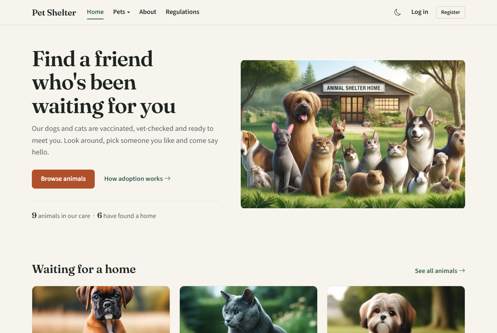
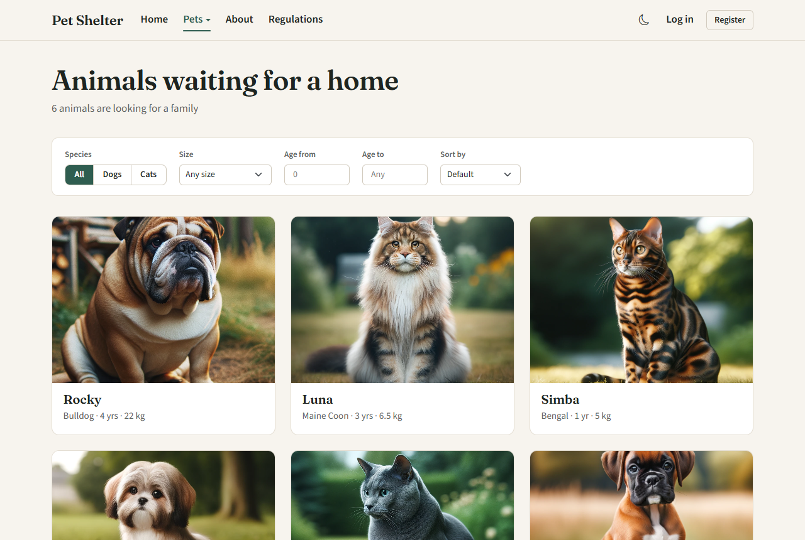
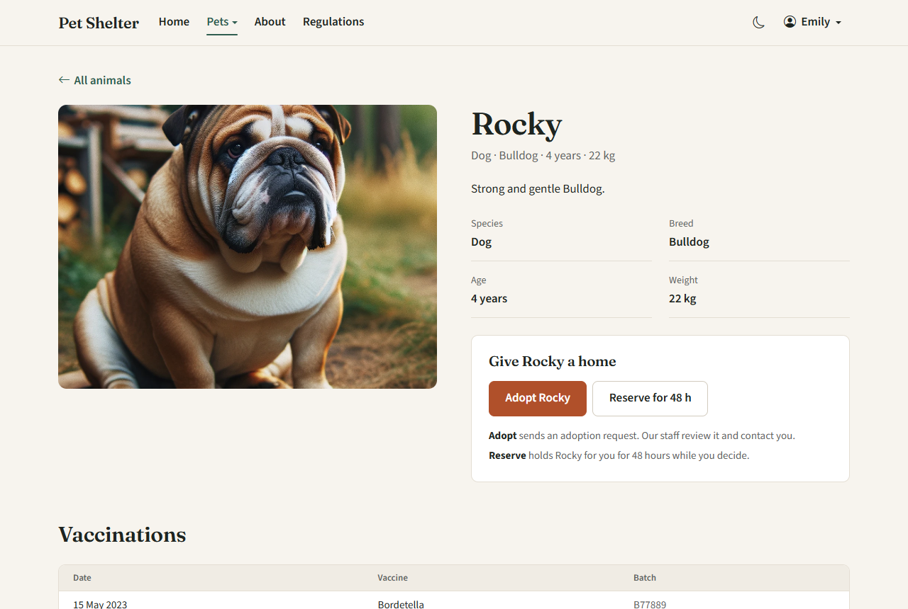
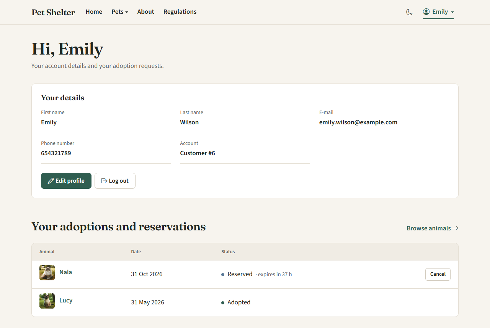
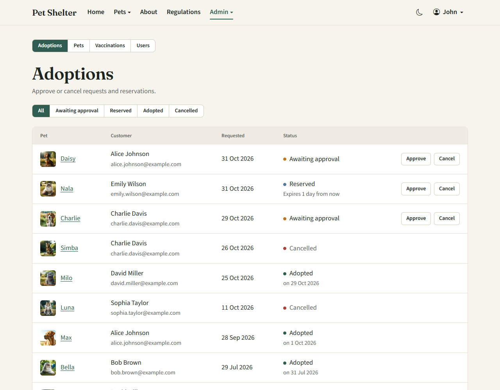
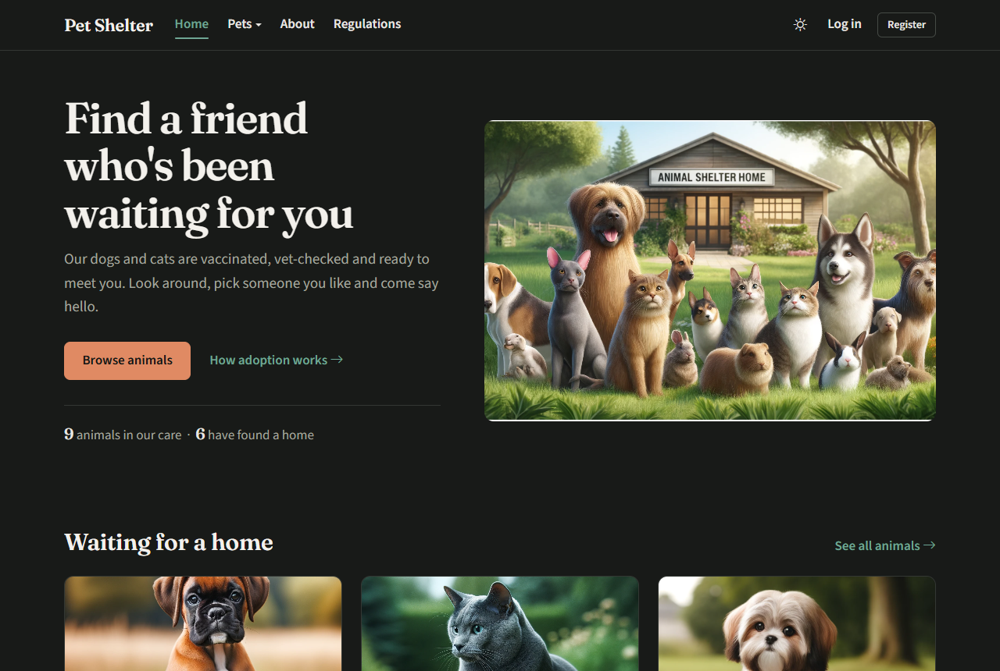
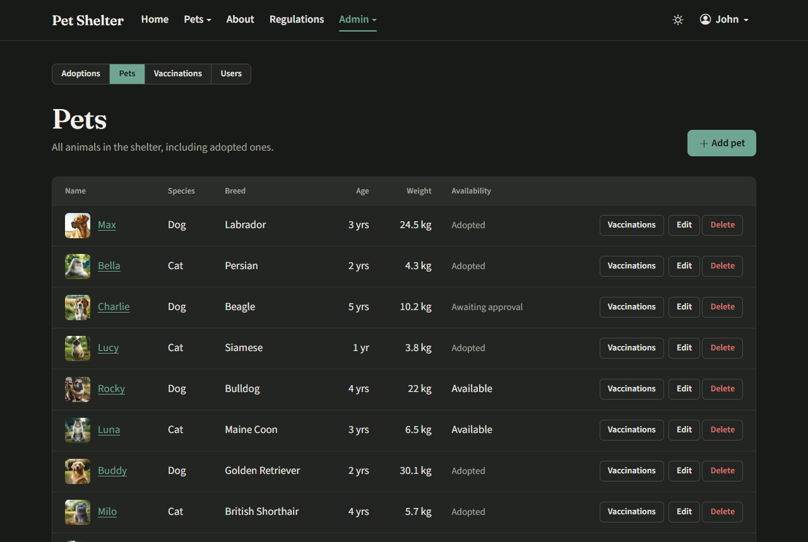
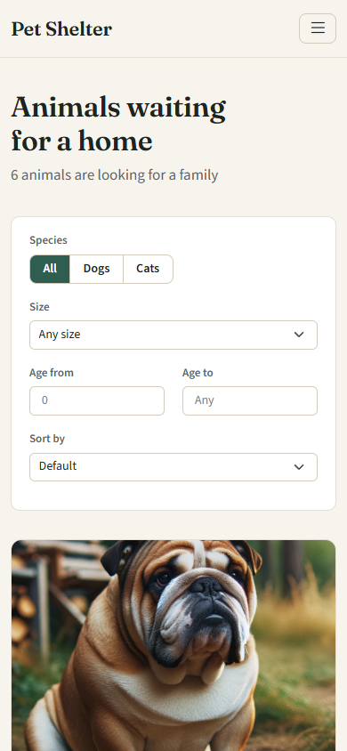

# Pet Shelter

A web application for a small animal shelter. Visitors browse dogs and cats waiting for a home, send adoption requests or reserve an animal for 48 hours. Shelter staff manage animals, vaccinations, users and approve adoptions.

Final project for the Web Applications course.



## Features

### For visitors and customers
- Browse available animals and filter them by species, size and age, sorted by age.
- See each animal's details and vaccination history.
- Send an adoption request, which staff review and approve.
- Reserve an animal for 48 hours. The reservation is cancelled automatically when it expires.
- Cancel your own pending request or reservation.
- Profile page with personal details, adoption history and password change.
- Light and dark theme. The choice is remembered, otherwise the system setting is used.

### For administrators
- Adoptions: list with status filter, approve or cancel requests and reservations, chart of completed adoptions over the last 12 months.
- Pets: add, edit and delete animals with photo upload.
- Vaccinations: record and delete vaccinations per animal.
- Users: edit user data and roles, delete accounts. An administrator cannot delete or demote their own account.

### Adoption statuses
| Status | Meaning |
|---|---|
| Awaiting approval | The customer sent an adoption request. |
| Reserved | The animal is held for the customer for 48 hours. |
| Adopted | An administrator approved the adoption. |
| Cancelled | Cancelled by the customer or an administrator, or the reservation expired. |

An animal with an active request, reservation or completed adoption is not shown as available.

## Screenshots

| | |
|---|---|
|  |  |
| Animals list with filters | Animal details for a logged-in customer |
|  |  |
| Customer profile with a reservation | Admin: adoptions |
|  |  |
| Dark theme | Admin: pets |

<p align="center"></p>

## Quick start with Docker

The only requirement is [Docker Desktop](https://www.docker.com/products/docker-desktop/) (or Docker Engine with the Compose plugin).

1. Clone the repository.
2. Run the setup script from the repository root:
   - Windows: `docker-setup.bat`
   - Linux / macOS: `./docker-setup.sh`

The script checks that Docker is running, builds the image, starts the containers and opens the app in the browser. On the first run the database is created and filled with sample data.

| Service | Address |
|---|---|
| App | http://localhost:8000 |
| phpMyAdmin | http://localhost:8081 |
| MySQL | `localhost:3307`, user `petshelter`, password `petshelter`, database `petShelter` |

Ports can be changed with the `APP_PORT`, `PMA_PORT` and `DB_PORT` environment variables. The containers restart together with Docker.

Useful commands (run from the repository root):

| Command | What it does |
|---|---|
| `docker compose up -d --build` | Rebuild and restart after code changes. Migrations run automatically. |
| `docker compose down` | Stop the app. Data stays in Docker volumes. |
| `docker compose down -v` | Stop the app and delete the database and uploaded photos. |
| `docker compose exec -u www-data app php artisan migrate:fresh --seed --force` | Reset the database to the sample data. |
| `docker compose logs -f app` | Follow the app logs. |

Run artisan commands in the container with `-u www-data`. Files created by root in `storage/` cause permission errors.

## Test accounts

All sample accounts use the password `Haslo12345@`.

| Role | E-mail |
|---|---|
| Admin | `john.doe@example.com`, `jane.smith@example.com` |
| Customer with a pending request | `alice.johnson@example.com` |
| Customer with a reservation | `emily.wilson@example.com` |
| Other customers | `bob.brown@example.com`, `charlie.davis@example.com`, `david.miller@example.com`, `sophia.taylor@example.com`, `michael.anderson@example.com`, `olivia.thomas@example.com` |

Login is limited to 5 failed attempts per minute.

## Manual setup without Docker

Requirements: PHP 8.2 or newer with the `pdo_mysql` extension, Composer, and MySQL 8.0.16 or newer (for example from XAMPP).

```bash
cd laravel
composer install
cp .env.example .env
php artisan key:generate
```

Create a database named `petShelter` and set the `DB_*` values in `laravel/.env`. Then:

```bash
php artisan migrate --seed
php artisan storage:link
php artisan serve
```

The app runs at http://127.0.0.1:8000.

## Reservation expiry

Expired reservations are cancelled in two ways:
- on every page request, so the data shown is always correct;
- by the `adoptions:expire-reservations` command, scheduled every 15 minutes. It runs only when the Laravel scheduler is running (`php artisan schedule:work`, or a cron entry with `php artisan schedule:run`).

The command can also be run by hand:

```bash
docker compose exec -u www-data app php artisan adoptions:expire-reservations
```

## Tests

Feature tests cover the animal list and filters, the adoption and reservation flow, the admin panel, authentication and the profile. They run against a separate database, `petShelter_test`, and refuse to run against any database whose name does not end with `_test`.

With Docker, create the test database once and run the tests:

```bash
docker compose exec db mysql -uroot -proot -e "CREATE DATABASE IF NOT EXISTS petShelter_test; GRANT ALL PRIVILEGES ON petShelter_test.* TO 'petshelter'@'%';"
docker compose exec -u www-data app php artisan test
```

Without Docker, create a `petShelter_test` database for the user from `.env` and run `php artisan test` in the `laravel` folder.

## Tech stack

- PHP 8.3 and Laravel 11
- MySQL 8.4
- Blade templates, Bootstrap 5, plain CSS and JavaScript with no build step
- Chart.js for the admin chart
- Docker: PHP with Apache, MySQL, phpMyAdmin

## Project structure

```
docker-compose.yml          Docker services: app, MySQL, phpMyAdmin
docker-setup.bat / .sh      First-time setup scripts
docs/screenshots/           Screenshots used in this README
laravel/
  app/Http/Controllers/     Public, profile and auth controllers
  app/Http/Controllers/Admin/  Admin panel controllers
  app/Models/               Pet, Adoption, Vaccination, User
  database/migrations/      Database schema
  database/seeders/         Sample data
  resources/views/          Blade templates
  public/css/app.css        Styles, colour tokens for both themes
  public/js/app.js          Theme switch, animations, small UI helpers
  tests/Feature/            Feature tests
```

## Documentation

Project documentation in Polish: [Documentation Polish.pdf](Documentation%20Polish.pdf) and [laravel/Dokumentacja.pdf](laravel/Dokumentacja.pdf).

## License

[GNU GPL v3](LICENSE)
